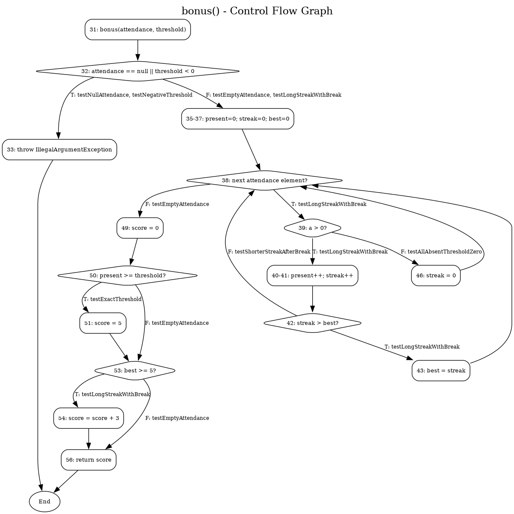

# Лаборатори №10 — Өгөгдлийн урсгалын тест (Definition–Use хосууд)

**Оюутны нэр:** Ж.Буянхишиг  
**Оюутны код:** B232270114  
**GitHub:** https://github.com/Buyka1108/lab10-dataflow  
**Үндсэн branch:** `main`

## 1. Лабораторийн зорилго

Java програмын хувьсагчийн **definition (def)** болон **use** цэгүүдийг тодорхойлж, тэдгээрийн хоорондох **def-clear** замыг шинжлэх, **all-defs** болон **all-DU-pairs** шалгуурыг JUnit 5 тестээр хэрэгжүүлэх, JaCoCo хамралт болон алдаа зориуд оруулах (fault seeding) туршилтын үр дүнг харьцуулахад оршино.

## 2. Ашигласан технологи ба орчин

- Ubuntu WSL2, Visual Studio Code
- OpenJDK 17 (`17.0.20.1`)
- Apache Maven `3.9.12`
- JUnit 5, JaCoCo `0.8.12`
- Git, GitHub

**Java хувилбар (`java -version`):**

```text
openjdk version "17.0.20.1" 2026-08-18
OpenJDK Runtime Environment (build 17.0.20.1+1-1-26.04-Ubuntu)
OpenJDK 64-Bit Server VM (build 17.0.20.1+1-1-26.04-Ubuntu, mixed mode, sharing)
```

**Maven (`mvn -version`):**

```text
Apache Maven 3.9.12
Maven home: /usr/share/maven
Java version: 17.0.20.1, vendor: Ubuntu, runtime: /usr/lib/jvm/java-17-openjdk-amd64
Default locale: en, platform encoding: UTF-8
OS name: "linux", version: "6.6.114.1-microsoft-standard-wsl2", arch: "amd64", family: "unix"
```

## 3. Төслийн бүтэц, Git

Starter төслийг Windows-оос Ubuntu WSL2 руу хуулж, `/home/bbuyk/lab10-dataflow` хавтсанд ажиллуулсан.

```text
lab10-dataflow/
├── .gitignore
├── pom.xml
├── README.md
├── cfg-bonus.dot
├── cfg-bonus.png
├── docs/
│   └── bonus-du-analysis.md
├── results/
│   ├── jacoco-alldefs.csv
│   ├── jacoco-final.csv
│   ├── mvn-verify-alldefs.txt
│   ├── mvn-verify-final.txt
│   ├── mvn-test-M1.txt
│   ├── mvn-test-M2.txt
│   ├── mvn-test-M2-kill.txt
│   └── mvn-test-M3.txt
└── src/
    ├── main/java/mn/edu/must/sqat/DataFlowTargets.java
    └── test/java/mn/edu/must/sqat/
        ├── GcdTest.java
        └── BonusTest.java
```

GitHub repository: https://github.com/Buyka1108/lab10-dataflow. Эхний commit: `1623ea0` (`Starter`). All-defs үеийн тестүүдийг `eefd6df` commit-оос шалгасан; all-DU-pairs үе шат тусдаа хийгдсэн. Эцсийн өөрчлөлтүүдийг `main` branch дээр хадгална.

## 4. Онол: definition, use, def-clear

- **Definition (def):** хувьсагчид шинэ утга оноох, мөн функцийн параметрээр утга хүлээн авах цэг.
- **c-use (computational use):** тооцоолол, оноолтын баруун тал, `return` зэрэгт хувьсагчийн утгыг ашиглах.
- **p-use (predicate use):** `if`, `while` зэрэг нөхцөлд утгыг ашиглах.
- **Def-clear path:** сонгосон definition-оос use хүртэл тухайн хувьсагчийг **дахин тодорхойлоогүй** гүйцэтгэлийн зам.
- **All-defs:** хүрч болох definition бүрээс ядаж нэг use рүү def-clear замаар хүрэх.
- **All-DU-pairs:** боломжтой definition–use хос бүрийг def-clear замаар гүйцэтгэх. Хүрэх боломжгүй (infeasible) хосыг тайлбарлаж ялгана.

## 5. Хэсэг A — `gcd()` функц

### 5.1 Эх код

`DataFlowTargets.java` дахь Евклидийн алгоритм:

```java
public static int gcd(int x, int y) {  // 13
    int tmp;                            // 14
    while (y != 0) {                   // 15
        tmp = x % y;                   // 16
        x = y;                         // 17
        y = tmp;                       // 18
    }
    return x;                          // 20
}
```

`x`, `y`-ийн параметрийн анхны definition нь 13-р мөр; `tmp`-ийн definition нь 16-р мөр. `int tmp;` (14-р мөр) нь утга оноогоогүй тул initialized definition гэж тооцохгүй.

### 5.2 `gcd()`-ийн DU хүснэгт

| Хувьсагч | Def → Use | Төрөл | Def-clear зам / тайлбар | Тест |
|---|---|---|---|---|
| `x` | 13 → 16 | c-use | 13→15(T)→16; `x` дахин оноогдоогүй | G2 |
| `x` | 13 → 20 | c-use | 13→15(F)→20 | G1 |
| `x` | 17 → 16 | c-use | 17→18→15(T)→16 | G2 |
| `x` | 17 → 20 | c-use | 17→18→15(F)→20 | G2 |
| `y` | 13 → 15 | p-use | 13→15; анхны нөхцөл | G1, G2 |
| `y` | 13 → 16 | c-use | 13→15(T)→16 | G2 |
| `y` | 13 → 17 | c-use | 13→15(T)→16→17 | G2 |
| `y` | 18 → 15 | p-use | 18→15; дараагийн нөхцөл | G2 |
| `y` | 18 → 16 | c-use | 18→15(T)→16 | G2 |
| `y` | 18 → 17 | c-use | 18→15(T)→16→17 | G2 |
| `tmp` | 16 → 18 | c-use | 16→17→18; `tmp` дахин оноогдоогүй | G2 |

**Тэмдэглэгээ:** T = нөхцөл үнэн, F = худал. `y`-ийн 15-р мөрийн p-use нь үнэн, худал салаанд тус тус хамаарна; хүснэгтэд мөрийн түвшинд нэгтгэн харуулав.

### 5.3 JUnit тестүүд

```java
@Test
@DisplayName("G1: zero iterations, x line 13 to line 20")
void testZeroIteration() {
    assertEquals(7, DataFlowTargets.gcd(7, 0));
}

@Test
@DisplayName("G2: multiple iterations, loop-carried DU pairs")
void testMultipleIterations() {
    assertEquals(4, DataFlowTargets.gcd(12, 8));
}

@Test
@DisplayName("G3: initial x zero")
void testInitialXZero() {
    assertEquals(5, DataFlowTargets.gcd(0, 5));
}
```

G1 нь давталтгүй замыг, G2 нь давталтын үеийн definition/use болон loop-carried хосуудыг, G3 нь `x=0` захын тохиолдлыг шалгана.

## 6. Хэсэг B — `bonus()` функц

### 6.1 Эх код ба CFG

```java
public static int bonus(int[] attendance, int threshold) { // 31
    if (attendance == null || threshold < 0) {            // 32
        throw new IllegalArgumentException("Буруу оролт"); // 33
    }
    int present = 0;                                      // 35
    int streak = 0;                                       // 36
    int best = 0;                                         // 37
    for (int a : attendance) {                            // 38
        if (a > 0) {                                      // 39
            present = present + 1;                        // 40
            streak = streak + 1;                          // 41
            if (streak > best) {                          // 42
                best = streak;                            // 43
            }
        } else {
            streak = 0;                                   // 46
        }
    }
    int score = 0;                                        // 49
    if (present >= threshold) {                           // 50
        score = 5;                                        // 51
    }
    if (best >= 5) {                                      // 53
        score = score + 3;                                // 54
    }
    return score;                                         // 56
}
```



CFG эх файл: [`cfg-bonus.dot`](cfg-bonus.dot). Дэлгэрэнгүй тайлбар: [`docs/bonus-du-analysis.md`](docs/bonus-du-analysis.md).

### 6.2 `bonus()`-ийн DU хүснэгт

Доорх нь **сонгосон 23 DU хос** юм. `a` хувьсагчийн definition нь `for-each` давталтын тухайн итерацад 38-р мөр дээр үүснэ. Замыг мөрийн дугаараар товч илэрхийлсэн; `→` нь удирдлагын урсгалыг, `…` нь хоорондын нөхцөл/давталтыг тэмдэглэнэ.

| Хувьсагч | Def → Use | Төрөл | Def-clear зам / тайлбар |
|---|---|---|---|
| `attendance` | 31 → 32 | p-use | 31→32; `null` шалгалтад уншина |
| `attendance` | 31 → 38 | c-use | 31→32(F)→35→36→37→38 |
| `threshold` | 31 → 32 | p-use | 31→32; `attendance != null` үед `threshold < 0` шалгана |
| `threshold` | 31 → 50 | p-use | 31→32(F)→…→49→50 |
| `a` | 38 → 39 | p-use | 38→39; тухайн итерацын `a` |
| `present` | 35 → 40 | c-use | 35→36→37→38→39(T)→40 |
| `present` | 35 → 50 | p-use | 35→…→38(F)→49→50; хоосон массив |
| `present` | 40 → 40 | c-use | 40→…→38→39(T)→40; дараагийн ирсэн өдөр |
| `present` | 40 → 50 | p-use | 40→…→38(F)→49→50 |
| `streak` | 36 → 41 | c-use | 36→37→38→39(T)→40→41 |
| `streak` | 41 → 41 | c-use | 41→42→…→38→39(T)→40→41; завсаргүй дараалсан ирц |
| `streak` | 41 → 42 | p-use | 41→42; тухайн өдрийн streak |
| `streak` | 41 → 43 | c-use | 41→42(T)→43 |
| `streak` | 46 → 41 | c-use | 46→38→39(T)→40→41; тасарсны дараах эхний ирц |
| `best` | 37 → 42 | p-use | 37→38→39(T)→40→41→42 |
| `best` | 37 → 53 | p-use | 37→38(F)→49→50→53; хоосон массив |
| `best` | 43 → 42 | p-use | 43→…→38→39(T)→40→41→42; дараагийн ирц |
| `best` | 43 → 53 | p-use | 43→…→38(F)→49→50→53 |
| `score` | 49 → 54 | c-use | 49→50(F)→53(T)→54; босго хүрээгүй ч 5+ дараалсан ирцтэй |
| `score` | 49 → 56 | c-use | 49→50(F)→53(F)→56 |
| `score` | 51 → 54 | c-use | 51→53(T)→54 |
| `score` | 51 → 56 | c-use | 51→53(F)→56 |
| `score` | 54 → 56 | c-use | 54→56 |

**Нөхцөл ашиглалтын нарийвчлал:** `attendance == null`, `threshold < 0`, `a > 0`, `streak > best`, `present >= threshold`, `best >= 5` нь нөхцөл тул эдгээр мөрөн дэх хувьсагчийн ашиглалтыг **p-use** гэж тэмдэглэсэн.

### 6.3 `streak = 0` (46-р мөр) — kill ба def-clear

46-р мөрийн `streak = 0` нь өмнө нь 36 эсвэл 41-р мөр дээр тодорхойлогдсон `streak`-ийн утгыг **kill** буюу хүчингүй болгоно. Жишээлбэл, `{1, 1, 0, 1}` массив дээр эхний хоёр ирцийн дараа `streak = 2`, гурав дахь өдөр `a=0` тул 46-р мөр ажиллаж `streak = 0` болно. Дараагийн ирсэн өдөр 41-р мөрийн баруун талд **46-р мөрийн definition** ашиглагдана (`46→41`). Харин 46-р мөрөөс 42 эсвэл 43-р мөр рүү **def-clear** зам байхгүй: 42, 43-т хүрэхээс өмнө 41-р мөр `streak`-ийг заавал дахин тодорхойлно. Тиймээс `streak:46→42`, `streak:46→43` хосууд **infeasible**. Үүнтэй адил `streak:36→42` нь 41-р мөрөөр заавал дахин тодорхойлогдох тул infeasible.

### 6.4 JUnit тестүүд

`BonusTest.java` файлд нийт 9 тест хэрэгжүүлсэн:

| Тест | Зорилго |
|---|---|
| `testLongStreakWithBreak` (B1) | Урт streak, тасалдал, `score=8` |
| `testEmptyAttendance` (B2) | Хоосон массив, `score=0` |
| `testAllAbsentThresholdZero` | Ирцгүй, босго 0 |
| `testExactThreshold` | Босго яг хангагдах |
| `testLongStreakBelowThreshold` | Урт streak боловч ирцийн босго хүрэхгүй |
| `testNullAttendance` | `null` оролтын exception |
| `testNegativeThreshold` | Сөрөг босгын exception |
| `testShorterStreakAfterBreak` | Тасалдсаны дараах богино streak |
| `testSeparatedAttendanceNoLongStreak` | M2 алдааг илрүүлэх нэмэлт тест |

Эцсийн байдлаар `GcdTest`-ийн 3, `BonusTest`-ийн 9, нийт **12 тест** байна.

## 7. All-defs — хамгийн бага тестийн тооны баталгаа

All-defs үе шатны бодит commit `eefd6df`-д **G1, G2, G3, B1, B2 = 5 тест** байсан. Энэ нь гүйцэтгэсэн тестийн тоо бөгөөд **математик утгаар хамгийн бага тоо биш**.

### 7.1 `gcd()` — хамгийн бага 1 тест

**G2: `gcd(12,8)`** ганцаараа all-defs-ийг хангана. Давталт эхлэхэд параметрийн анхны definition (`x:13`, `y:13`) нь 15, 16, 17-р мөрийн use-д хүрнэ. Давталтын үед `tmp:16→18`, `x:17→16` (дараагийн давталт), `x:17→20` (сүүлийн давталт), `y:18→15` хосууд гүйцэтгэгдэнэ. Иймээс бүх хүрч болох definition ядаж нэг use-тэй. Нэг ч тестгүй үед definition/use-г гүйцэтгэхгүй тул **дор хаяж 1 тест** хэрэгтэй; G2 үүнийг хангана.

G1 нь давталтгүй замыг, G3 нь `x=0` захын тохиолдлыг нэмэлтээр шалгадаг. Тэд all-defs-ийн хамгийн бага тоонд заавал шаардагдахгүй ч илүү өргөн DU болон функциональ хамралтад хэрэгтэй.

### 7.2 `bonus()` — хамгийн бага 2 тест

- **B1:** `attendance={1,1,1,1,1,0,1}`, `threshold=6`, хүлээгдсэн `score=8`. Энэ нь `present:35/40`, `streak:36/41/46`, `best:37/43`, `score:51/54` зэрэг хүрч болох definition-уудын use-г шалгана.
- **B2:** `attendance={}`, `threshold=1`, хүлээгдсэн `score=0`. Энэ нь `present:35→50`, `best:37→53`, `score:49→56` зэрэг давталтгүй замын use-г шалгана.

**Яагаад 1 тест хангалтгүй вэ?** `score`-ийн 49-р мөрийн definition (`score=0`) нь `score=5` (51-р мөр) ажиллавал kill болно. 51-р мөрийн definition-ийн use-г шалгахын тулд `present >= threshold` үнэн байх ёстой. Харин 49-р мөрийн definition-ээс use (`54` эсвэл `56`) хүртэл def-clear хүрэхийн тулд 51-р мөр ажиллахгүй байх ёстой. Нэг удаагийн `bonus()` дуудлагад 50-р мөрийн нөхцөл нэг л удаа шийдэгддэг тул **нэг тестээр хоёуланг хангах боломжгүй**. B1 ба B2 нь энэ хоёр замыг тус тус гүйцэтгэдэг. Иймээс хамгийн бага **2 тест**.

### 7.3 Нийт хамгийн бага 3 тест

`gcd()`-д 1 (G2), `bonus()`-д 2 (B1, B2), нийт **3 тест** нь all-defs-ийн онолын хамгийн бага багц юм. Хоёр функцийг тус тусад нь дуудаж шалгах JUnit тестийн тоогоор тооцсон. Туршилтад ашигласан **5 тест** нь үүнээс олон бөгөөд G1, G3 гэсэн нэмэлт замуудыг шалгадаг.

> **Хамрах хүрээ:** Энэ баталгаа нь дээрх хоёр функцийн хүрч болох definition/use-ууд болон `eefd6df` үеийн тестийн оролтуудад тулгуурласан; infeasible хосуудыг all-defs-ийн зайлшгүй нөхцөл гэж тооцоогүй.

## 8. All-DU-pairs ба branch coverage-ийн ялгаа

**Branch coverage = 100%** гэдэг нь нөхцөлийн салаа бүр ядаж нэг удаа гүйцэтгэгдсэнийг илэрхийлнэ. Харин **all-DU-pairs** нь тодорхой definition-оос тодорхой use хүртэлх def-clear замыг шаарддаг. Тиймээс 100% branch coverage нь DU coverage 100% гэсэн баталгаа **биш**.

**Тодорхой эсрэг жишээ (тусгайлан байгуулсан тестийн багц):** `bonus({1,1,1,1,1,0}, 6)`, `bonus({}, 1)`, `bonus(null, 1)`, `bonus({}, -1)` гэх мэт тестээр 39-р мөрийн үнэн/худал, 42-р мөрийн үнэн/худал, 50 ба 53-р мөрийн үнэн/худал салааг нэмэлт тохирох оролтоор хамруулж болно. Гэхдээ **0-ийн дараа дахин 1 ордоггүй** тестүүдээр `streak:46→41` DU хос хэзээ ч гүйцэтгэгдэхгүй. Тэгэхээр бүх салааг хамруулсан багц ч уг DU хосыг алдаж болно. Энэ нь **жишээ багц**, одоогийн 12 тест DU хосыг алдсан гэсэн нотолгоо биш.

Мөн M2 (`best=present`) алдаа эхний 11 тестэд илрээгүй боловч JaCoCo-ийн branch coverage 100% байсан нь **салааны хамралт алдааг илрүүлэх баталгаа биш** гэдгийг харуулсан. JaCoCo нь DU-pairs хамралтыг шууд тооцдоггүй.

## 9. JaCoCo хамралт ба тестийн үр дүн

`mvn clean verify` ажиллуулж, `target/site/jacoco/index.html` болон `target/site/jacoco/jacoco.csv` тайлан үүсгэсэн.

| Үзүүлэлт | All-defs үе (5 тест) | Эхний 11 тестийн дараа |
|---|---:|---:|
| Branch coverage | 87.50% | 100% |
| Line coverage | 91.67% | 95.83% |
| Instruction coverage | 90.12% | 96.30% |

Эдгээр нь `DataFlowTargets` классын түвшний үзүүлэлтүүд. M2-г илрүүлэх 12 дахь тестийг нэмсний дараа зөв эх код дээр **12/12 PASS**, **BUILD SUCCESS**; эцсийн классын түвшний branch coverage **100%**, line coverage **95.83%**, instruction coverage **96.30%**.

Тайлангууд: `results/mvn-verify-alldefs.txt`, `results/jacoco-alldefs.csv`, `results/mvn-verify-final.txt`, `results/jacoco-final.csv`.

## 10. Хэсэг C — Fault Seeding (M1, M2, M3)

Эдгээр алдааг түр хугацаанд оруулж тестэлсэн; эцэст нь эх кодыг сэргээсэн.

| Мутаци | Түр өөрчлөлт | Ажигласан үр дүн |
|---|---|---|
| M1 | `streak = streak + 1`-ийг устгах/идэвхгүй болгох | Эхний 11 тестээс 2 FAIL |
| M2 | `best = streak` → `best = present` | Эхний 11 тест бүгд PASS; нэмэлт тесттэй 12-оос 1 FAIL |
| M3 | `int total = present + best;` ашиглагдахгүй мөр нэмэх | 11 тест PASS |

### 10.1 M1 — Streak нэмэгдүүлэх үйлдлийг устгасан

`streak = streak + 1` үйлдлийг устгаснаар дараалсан ирцийн тоо нэмэгдэхгүй болж, `best >= 5` нөхцөл биелэхгүй болсон.

**M1 алдаатай кодын тестийн үр дүн:**

| Амжилтгүй тест | Expected | Actual |
|---|---:|---:|
| `testLongStreakBelowThreshold` | 3 | 0 |
| `testLongStreakWithBreak` | 8 | 5 |

`results/mvn-test-M1.txt` логт нийт 8 тест ажилласнаас 2 нь FAIL болсон нь бүртгэгдсэн.

**Дүгнэлт:** M1 алдаа нь `streak` хувьсагчийн утга болон түүнээс хамаарах `best`, `score` тооцоололд нөлөөлсөн. Иймээс JUnit тестүүд уг алдааг амжилттай илрүүлсэн.

### 10.2 M2 — `best = present`

`best` нь **хамгийн урт тасралтгүй ирц** байх ёстой, харин `present` нь **нийт ирсэн өдрийн тоо**. Эхний 11 тестэд эдгээр утгын ялгаа оноонд нөлөөлөхөөр тусгаарлагдаагүй байсан: урт streak-тэй тохиолдолд хоёулаа `best>=5`-ийг үнэн болгох, бусад тохиолдолд ялгаа 3 онооны салааг өөрчлөхгүй байж болно. Иймээс M2 **11/11 PASS** буюу анх амьд үлдсэн.

Нэмсэн тест:

```java
@Test
void testSeparatedAttendanceNoLongStreak() {
    int[] attendance = {1, 0, 1, 0, 1, 0, 1, 0, 1};
    assertEquals(5, DataFlowTargets.bonus(attendance, 5));
}
```

Энд `present=5`, харин `best=1`. Зөв код **5** буцаана; M2 алдаатай код `best=present=5` гэж тооцоод **8** буцаана. Иймээс M2-той үед 12 тестээс **1 FAIL**; эх кодыг сэргээсний дараа **12/12 PASS**.

Лог: `results/mvn-test-M2.txt` болон `results/mvn-test-M2-kill.txt`.

### 10.3 M3 — ашиглагдахгүй definition

```java
int total = present + best;
```

`total`-д утга оноосон ч дараа нь уншихгүй, оноонд болон `return` утгад нөлөөлөхгүй. Иймээс JUnit-ийн үр дүнгээр илрэхгүй, **11/11 PASS**. Энэ нь **dead definition / unused local variable**-ийн жишээ. Илрүүлэхийн тулд IDE-ийн **unused variable inspection**, `javac`/IDE-ийн тохирох анхааруулга, эсвэл unused-local дүрэмтэй статик шинжилгээний хэрэгсэл (жишээ нь тохируулсан **PMD**) ашиглаж болно. **JaCoCo-ийн 100% branch coverage энэ төрлийн алдааг илрүүлэхгүй.**

Лог: `results/mvn-test-M3.txt`.

## 11. Эцсийн баталгаажуулалт

Зөв эх кодыг сэргээсний дараа:

```bash
mvn clean verify
```

Ажигласан үр дүн:

```text
GcdTest:   3 PASS
BonusTest: 9 PASS
Total:    12 PASS
Failures: 0
Errors:   0
BUILD SUCCESS
```

JaCoCo-ийн эцсийн классын түвшний үзүүлэлт: **branch 100%**, **line 95.83%**, **instruction 96.30%**.

Эцсийн Maven лог: [`results/mvn-verify-final.txt`](results/mvn-verify-final.txt).  
Эцсийн JaCoCo CSV: [`results/jacoco-final.csv`](results/jacoco-final.csv).

## 12. Дүгнэлт

1. `gcd()` болон `bonus()`-ийн definition/use, c-use/p-use, def-clear замыг шинжилж, JUnit тестээр баталгаажуулсан.
2. All-defs үеийн 5 тестээс онолын хамгийн бага **3 тест** (G2, B1, B2) байхад all-defs хангагдахыг үндэслэсэн.
3. `streak=0` (46-р мөр) нь өмнөх definition-ийг kill хийдэг; 46→41 нь боломжтой, 46→42 нь def-clear биш тул infeasible.
4. JaCoCo-ийн **100% branch coverage** нь DU хос бүр хамрагдсан, эсвэл алдаа бүр илэрсэн гэсэн баталгаа биш.
5. M1 алдаа 2 тестээр илэрсэн; M2 анхны 11 тестэд илрээгүй ч 12 дахь тестээр илэрсэн; M3 нь програмын гаралтад нөлөөгүй dead definition тул статик шинжилгээ шаарддаг.
6. Эцсийн зөв эх код дээр **12 тест бүгд PASS**, **BUILD SUCCESS** болсон.

---

